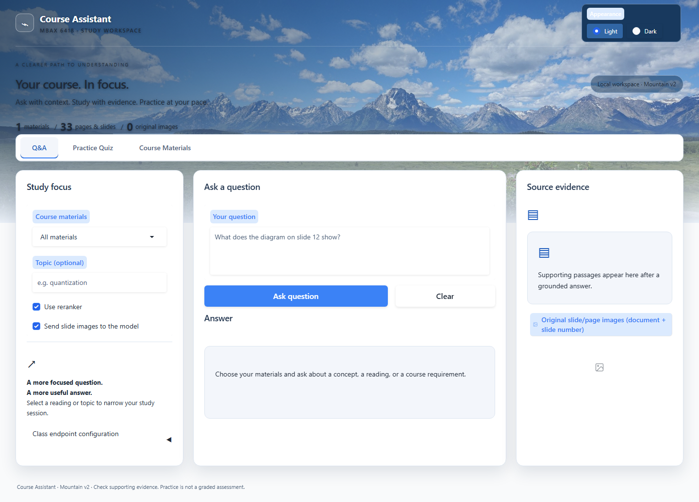
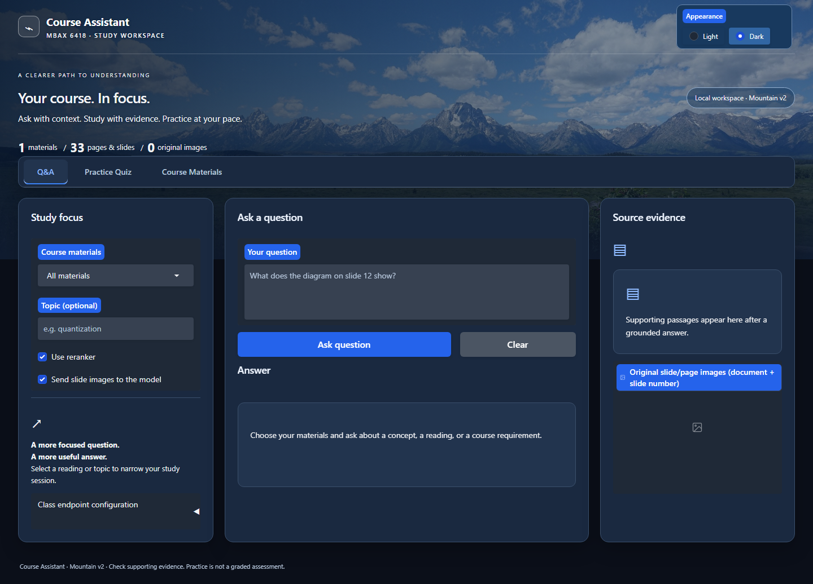
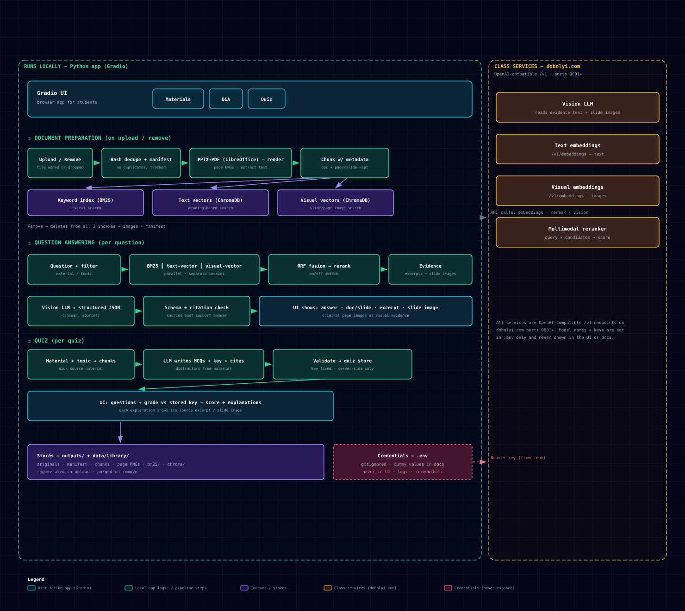

# course-assistant

MBAX 6418: Business Generative AI and LLM Course Assistant

A generic, app-managed hybrid multimodal RAG app: students upload **their
own** course materials (PDF/PPTX), ask grounded questions with visual
evidence, and generate practice quizzes — built with Python (bm25s, ChromaDB,
Gradio) and the class services on `dobolyi.com:9001+`. No course file is
hardcoded anywhere; the corpus is whatever the user adds in the app.

> Setup, usage, evaluation findings, and limitations are documented below.
> See `PROGRESS.md` for the step-by-step build log.

## Default interface: Mountain Master

**Mountain Master is the main interface on the Meaghan branch**, combining the mountain dashboard design with the course backend. It includes **Q&A**, **Practice Quiz**, **Course Materials**, and a persistent **Light / Dark** appearance control. The interface displays the design label **Mountain v2**.

### Open on Windows

Download `Start Course Assistant.bat` from this page, place it in the `course-assistant` folder, then double-click it. It installs dependencies and opens the dashboard in your browser. Keep the window open while using the app.

For detailed dashboard instructions, see [README-DASHBOARD.md](README-DASHBOARD.md).

### Preview

**Light mode**



**Dark mode**



### Manual setup (macOS/Linux)

First, navigate into your cloned repository (`/path/to/course-assistant` is a
placeholder — replace it with the actual location of your clone):

```bash
cd /path/to/course-assistant
```

Then install and launch from inside that directory:

```bash
uv venv --python 3.11 .venv
uv pip install --python .venv/bin/python -r requirements-dashboard.txt
cp .env.example .env          # only if .env does not already exist; configure locally
.venv/bin/python -m src.app   # opens the default Mountain interface
```

On Windows, use `.venv\Scripts\python.exe` instead of `.venv/bin/python`. All launch methods use `src.app`; the older standalone dashboard modules are not alternate entry points.

**Materials management (works with zero configuration):** in the app's
Materials tab, upload **PDF** or **PPTX** files (these are the two supported
formats; other file types are rejected with a clear message). The same file
uploaded twice is a no-op (content-hash dedupe); removing a document purges
its text, images, and index entries. **PPTX files are converted to PDF with
LibreOffice** (install: `brew install --cask libreoffice`; without it,
export the deck to PDF yourself and upload that instead). PDF parsing and
PPTX→PDF conversion run locally; no class endpoint is required for uploads.

**Q&A and Quiz tabs activate once `.env` has the class endpoints** (vision
chat LLM, text/visual embeddings, multimodal reranker — `dobolyi.com:9001+`).
Until then the app clearly reports which services are missing.

### Configuring the class endpoints

The `.env` file maps one variable set per service. The class endpoints file
provided by the course staff lists, for each port, a base URL, an API key,
and a model name. Map them like this (values shown are dummy examples — put
your real values in `.env`, never in this README or any committed file):

| Endpoint port | `.env` variables |
|---|---|
| `9001` — vision chat LLM | `CHAT_BASE_URL`, `CHAT_API_KEY`, `CHAT_MODEL` |
| `9002` — text embeddings | `TEXT_EMBED_BASE_URL`, `TEXT_EMBED_API_KEY`, `TEXT_EMBED_MODEL` |
| `9003` — visual embeddings | `VISUAL_EMBED_BASE_URL`, `VISUAL_EMBED_API_KEY`, `VISUAL_EMBED_MODEL` |
| `9004` — multimodal reranker | `RERANK_BASE_URL`, `RERANK_API_KEY`, `RERANK_MODEL` |

**Every base URL must include the `/v1` path.** The class endpoints file
omits `/v1` on some ports (notably 9002 and 9004); the app calls
`<base>/models`, `<base>/embeddings`, and `<base>/rerank` and gets HTTP 404
without the `/v1` prefix. So `http://dobolyi.com:9002/embeddings` will fail;
use `http://dobolyi.com:9002/v1/embeddings`. `CHAT_BASE_URL` should also end
in `/v1` (e.g. `http://dobolyi.com:9001/v1`). `.env.example` already shows
the correct `/v1` form for every service.

API keys are stored locally in `.env` only (chmod 600, gitignored) and are
never shown in the UI, logs, errors, screenshots, docs, tests, or GitHub.

### Running the tests

```bash
.venv/bin/python -m pytest -q
```

The suite is hermetic: it uses synthetic documents (no course files) and
runs with every class endpoint switched off unless a test deliberately
switches one on, so it needs no `.env` and no network. **Verified result on
this branch as of 2026-10-16: 114 passed, 4 skipped** — treat that as a
dated snapshot, not a promise; run the command above to check the current
result.

## Architecture



The app runs locally: the **Materials** tab ingests uploaded PDF/PPTX (dedupe
→ parse → render page/slide images → chunk → BM25 + text-vector +
visual-vector indexes), the **Q&A** tab retrieves evidence across the three
indexes (keyword always; vectors when configured), fuses with RRF, optionally
reranks, and answers with a vision LLM as structured `{answer, sources}`
(schema- and support-validated), showing the original slide images with
document + slide number; the **Quiz** tab generates MCQs from the selected
uploaded material with a fixed server-side answer key, scores, and
source-cited explanations. Interactive diagram: `docs/architecture.html`.

## Credentials

Real keys live only in the local, gitignored `.env` (dummy values in
`.env.example`). They are never shown in the UI, logs, errors, screenshots,
docs, or on GitHub.

---

## Grounded QA — evaluation findings (Savannah's task, 2026-10-08)

**What was tested:** the Q&A pipeline on a real corpus (Week 2 deck — 42
slides, Week 6 deck — 20 slides, Syllabus — 7 pages; all with rendered slide
images) against the live class services (chat `9001`, text embeddings `9002`,
reranker `9004`; visual embeddings `9003` was down during the run). A fixed
10-question set was answered at **temperature 0**, evidence budget 8
(`TOP_K_FINAL=8`), and every response was validated for schema + source
support. Full results: `outputs/findings/grounded_qa_eval_live_k8_20261008.json`.

| # | Question | Outcome | Source / note |
|---|---|---|---|
| 1 | What is quantization? | ✅ grounded | Week 2 p15–16, 5.4 s |
| 2 | What does fine-tuning do to a model's weights? | ⚠️ honest refusal | false negative (materials likely cover it) |
| 3 | Context window & why it matters for RAG | ❌ invalid | model output truncated mid-JSON; passed on rerun (flake, not systemic) |
| 4 | Launching a Gradio app for others | ⚠️ honest refusal | correctly outside this corpus |
| 5 | Quantization vs fine-tuning comparison | ✅ grounded | Week 2 p15, 20 s |
| 6 | Main components of RAG | ⚠️ honest refusal | correctly outside this corpus |
| 7 | **Vibe Coding "Prod" meme** | ✅ grounded (vision) | identified from the actual slide image, Week 2 p33 |
| 8 | RAG pipeline diagram | ⚠️ honest refusal | correctly outside this corpus |
| 9 | Capital of France | ✅ honest refusal | correct "not in materials" behavior |
| 10 | How was this assistant built? | ⚠️ honest refusal | correctly outside this corpus |

**Summary: 9/10 schema+support valid; 3 grounded answers with verifiable
sources; 6 honest refusals (5 correct, 1 false negative); vision path sent
slide images on 9/10 questions.** The one failure was an output-truncation
flake (the model started a correct answer but got cut off mid-JSON) — the
fallback ladder ran, and the same question passed on the rerun. Since the
run, `parse_json_response` gained truncation repair and the vision rung
sends a larger output budget, so this class of failure is mitigated.

**Design comparison (rerank ON vs OFF):** the same 10 questions, same
temperature, on the same corpus. Both configurations scored **10/10 valid**;
rerank ON averaged **8.9 s/question** vs **6.96 s offline**. Reranking did
not change correctness at this corpus size, but it re-orders low-quality
candidates ahead of better ones in larger libraries and costs under 2 s on
average — recommendation: **keep reranking ON**. Full per-question record:
`outputs/findings/grounded_qa_compare_rerank_latest.json`.

**Honest limitations:** the visual-embedding endpoint (9003) was unreachable
throughout the run, so the visual-*vector* retrieval leg is untested live
(the meme/diagram evidence came from text retrieval + slide images sent to
the vision model). One false negative (fine-tuning). Corpus here is 3 real
documents; results should be re-checked as the library grows. To reproduce:
`.env` with class endpoints, `python -m src.library add <files>`, then
`TOP_K_FINAL=8 python -m src.eval_qa` and
`TOP_K_FINAL=8 python -m src.eval_qa --compare-rerank`. Test suite at the
time of writing (baseline 2026-10-16, see "Running the tests" above):
**114 passed, 4 skipped** — rerun `.venv/bin/python -m pytest -q` for the
current status.

---

## Q&A reranking evaluation

A controlled Q&A evaluation used the Week 2, Week 3, and Week 5 decks plus the syllabus. The same ten questions were tested with reranking ON and OFF to compare answer correctness, source support, visual retrieval, and response time. Automated runs recorded the answers, retrieved evidence, validation results, and timing; manual review checked answer correctness, visual evidence, and UI behavior. This evaluation builds on the earlier grounded-QA testing above by using the final four-document test set and working visual embeddings.

**Design:** a frozen 10-question set (syllabus policy, slide text, the
required Week 2 "Vibe Coding on Prod" meme, an open-models table, the hybrid
RAG pipeline diagram, and one intentionally unanswerable question about the
Gradio default port) was run at temperature 0 with slide images enabled, in
two conditions that differ **only** in the reranking toggle (ON vs OFF).

**Correctness totals (manually verified against the source materials):**

| Condition | Correct | Partial | Incorrect |
|---|---|---|---|
| Reranking ON | 8/10 | 1 (Q1) | 1 (Q7) |
| Reranking OFF | 7/10 | 1 (Q1) | 2 (Q2, Q7) |

**Structured-output/source validation: 10/10 in both conditions.**

**Key findings:**

- **Q2 was the clearest reranking benefit.** Reranking ON promoted Week 2
  slides 15–16 into the evidence and produced a correct, grounded answer on
  quantization. With reranking OFF those slides were missed and the app
  honestly refused — no fabricated answer.
- Reranking also improved expected-source placement for Q1 and Q3, and no
  question had better supporting evidence with reranking OFF.
- **Q7 limitation (investigated, preserved):** neither condition retrieved
  Week 2 slide 22 (the "Popular Open Coding Models" table), so both runs gave
  honest refusals. This is a retrieval-recall limitation for that table slide,
  not a reranker defect.
- **Timing:** ON mean ≈ 6.4 s/question (median 5.2 s); OFF mean ≈ 9.1 s
  (median 4.6 s). Q6 OFF recorded 45.23 s in the official run, but a manual
  diagnostic rerun took ≈ 7 s, so that is treated as a one-off latency spike
  rather than a systematic OFF slowdown.
- **Recommendation: keep reranking ON** — it improved answer correctness and
  evidence ranking without an observed quality regression, at a modest
  latency overhead.

**UI findings (manual interface testing):** course-material labels are
excessively long; raw filenames/hashes appear instead of friendly titles; the
source-evidence icon appears broken; slide/page images are awkwardly cropped
or zoomed; extra gallery images are not clearly tied to cited sources; Q7
did not display slide 22, while Q8 displayed slide 33 and Q9 displayed slide
18 in both conditions.

**Full record:** `outputs/findings/evaluation_plan.md` (completed evaluation
record with the frozen question set, rubric, results table, and
interpretation). Raw automated results:
`outputs/findings/maddie_rerank_comparison_20261010-194347.json` and
`outputs/findings/maddie_rerank_comparison_latest.json`.
